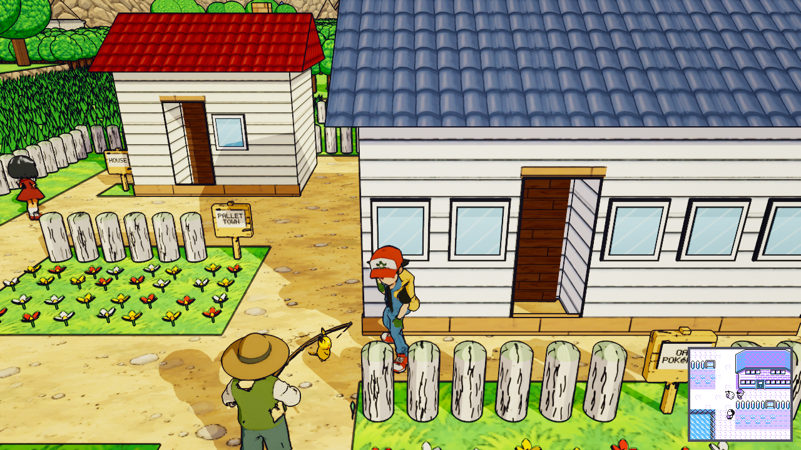
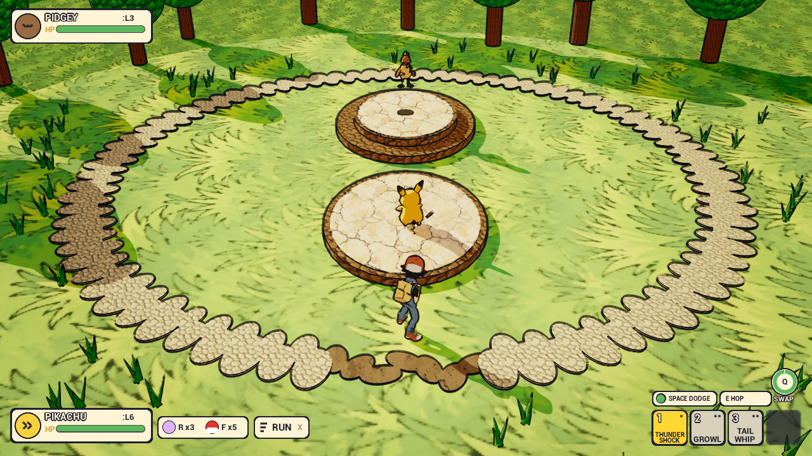
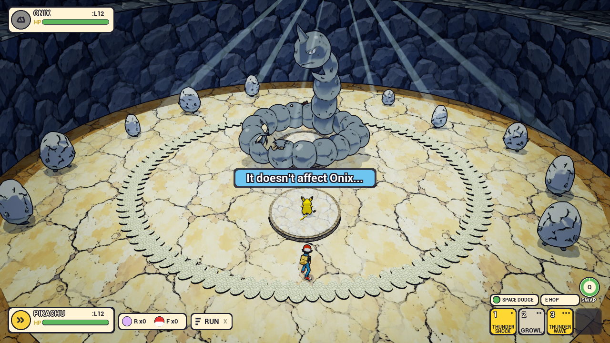
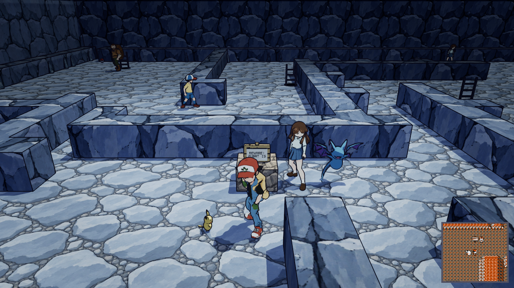
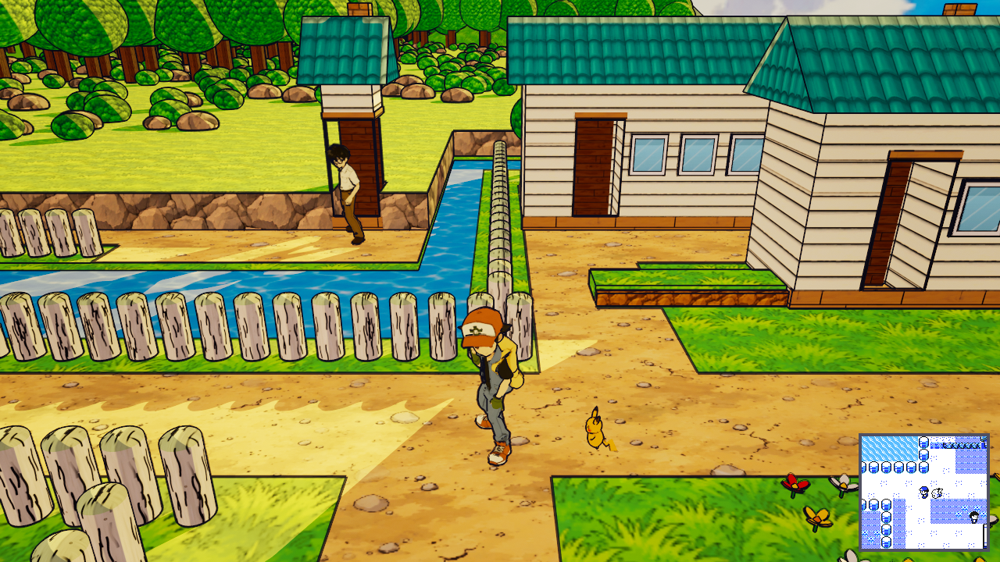

# Pokemon Yellow 3D

**Download (Windows, ~1 GB): [release v0.1](https://github.com/willgdjones/pokemon-yellow-3d/releases/tag/v0.1)**

Game Boy Pokemon Yellow from Pallet Town to Cerulean City, rebuilt tile for tile in 3D in Unreal Engine 5.8, with
real-time battles on anime-style stages. 46 maps in one seamless world (no loading screens), 188 people including 57
trainers, Brock and Misty, the rival, Jessie & James in Mt. Moon, Nugget Bridge and the S.S. Ticket. Pikachu walks a
tile behind you, never in a ball.

| | |
|---|---|
|  |  |
|  |  |

**What's new:** battles are real time. You steer your Pokemon; 1-4 fire moves that then cool down, Space dodges, and
switching pauses the fight. The Gen 1 numbers and Yellow's catch formula still apply.

**What's the same:** everything else. Every map, line of text, trainer team, wild table and tune is extracted from the
[pret/pokeyellow](https://github.com/pret/pokeyellow) disassembly into `YellowData/` and `YellowMusic/`. The music
plays the Game Boy's own notes, tempo, loops and vibrato; only the instruments are new (accordion, tin whistle,
upright bass, drums). The rule from the fourth milestone on: "pokeyellow is the law. Any difference is a bug."

**Status:** playable from a new game to Cerulean City, built 26 September to 7 October 2026. Windows only. It's an
experiment, not a finished game: expect rough edges.

**How it was made:** by AI coding agents working from a design brief, milestone by milestone, with reviewers from a
different AI company checking each change and an automated QA tour that walks the whole route. QA logged 278 bugs
over 27 runs (245 fixed, 33 accepted); the test suite grew from 85 tests to 415. The biggest lesson was about the
brief: the first milestone "reimagined" Kanto in the style of the TV show, and it only came right once the brief said
to copy the Game Boy map exactly.

**Licence:** code MIT ([LICENSE](LICENSE)). The Pokemon data, text and music derived from Game Freak's game are not
mine to license; see [THIRD_PARTY.md](THIRD_PARTY.md). Pokemon is a trademark of Nintendo, Creatures Inc. and GAME
FREAK inc. This is an unofficial, non-commercial fan project, not affiliated with or endorsed by them.

## Run the download
Unzip it anywhere and run `PokemonYellowReimagine.exe`. Keyboard and mouse or a gamepad; controls are below.

## Build from source
Open `PokemonYellowReimagine.uproject` with Unreal Engine 5.8 on Windows (Visual Studio 2022 with the C++ game
workload), or package with `RunUAT BuildCookRun -project=<path>/PokemonYellowReimagine.uproject -platform=Win64
-clientconfig=Shipping -build -cook -stage -pak -archive -archivedirectory=<out>`.

---

## Developer notes

Game Boy Pokemon Yellow from Pallet Town to Cerulean City, rebuilt tile for tile in 3D, with real-time battles on
anime-style stages. An Unreal Engine 5.8 C++ project, made with an AI agent pipeline; the design package is in
`design/`.

Since M4 the world, the people, the words and the music all come from two data folders made from the
pret/pokeyellow disassembly:
- **`YellowData/`** (by `Tools/yellowdata`): every map (tiles, looks, warps, connections, people, signs, items,
  hidden items), `text.json`, `items.json`, `marts.json`, `wild.json`, `trainers.json`, `trades.json`, `events.json`,
  `species.json`, `moves.json`, `exp.json`, `pikachu.json`, the minimap and Town Map pictures and Pikachu's faces.
- **`YellowMusic/`** (by `Tools/gbmusic`): the Game Boy tunes and jingles as WAV files with loop points (`music.json`).

Without `YellowData/` the game still starts, on a flat meadow, and the log names each missing file
(`YellowData missing: <path>`). Without `YellowMusic/` the old folk tracks play instead. For a run against another
checkout's data pass `-YellowDataDir=<folder>` and `-YellowMusicDir=<folder>`.

## The world
- **Tile exact.** One Game Boy tile is 1 m. Kanto X runs east, Y south; a tile's centre is at
  `((origin + x + 0.5) * 100, (origin + y + 0.5) * 100, 0)` cm. Every map in `manifest.json` is built at runtime in the
  one level (`Kanto/YellowWorld`): no OpenLevel, no streaming, no loading screen. Pallet Town to Cerulean City means
  Routes 1, 2, 3, 4, 22, 24 and 25, Viridian Forest, Mt. Moon and every interior on the way.
- **Collision is the `tiles` layer.** `#`, `w`, `x`, `=` and ledges are solid, merged into boxes. `blocked_edges` are
  thin walls. Red walks freely (not tile by tile) and slides along walls.
- **Looks** (`Kanto/YellowWorldLook.cpp`) dress each tile from the `looks` layer: ground, paths, water, trees, tall
  grass, flowers, fences, ledges, rocks, cave walls, counters, shelves, PCs, buildings with doors, roofs and signs.
- **People, signs, items** (`Kanto/PYRPeople`) stand on their tiles. Walkers wander near home along their axis;
  trainers watch their sight line. Item balls give their item once; hidden items are found by pressing E on or
  facing their tile.
- **Doors and exits.** A warp tile takes Red to its partner warp with a short fade. Outside a door he steps one tile
  down, as on the Game Boy; standing on an exit mat and pushing out leaves.

## Controls
On the road (the mouse is captured; it turns the camera):
- **WASD:** walk. **Shift (hold):** run. **E:** talk, read, take, use the PC (Space too). Facing Pikachu, E (or
  **T**) shows how it feels.
- **Enter or Esc:** the START menu. In menus W/S/A/D or the arrows move, E, Space or Enter confirm, Esc, Q or
  Backspace go back. The mouse is free only while a menu is open. Esc or Enter skips Oak's opening.
- **Naming screen:** type the name on the keyboard (Shift for lower case, Backspace deletes, Enter ends it; seven
  letters at most), or pick letters on Yellow's grid with the arrows and E, and ED to finish.
- **Ledges:** walk off a ledge's lip to hop down; you can't climb back up.

The START menu has the Game Boy's entries in order: POKéDEX (once Oak gives it), POKéMON, ITEM, the player's name
(the trainer card with the badge case), SAVE, OPTION and EXIT.
- **POKéMON:** the party, with STATS (two pages) and SWITCH.
- **ITEM:** 20 bag slots with USE, TOSS and SELECT. Key items can't be tossed; TMs teach their move.
- **SAVE:** saves everything (see below).
- **OPTION:** text speed (it really changes the letter delay), battle animation, battle style and sound.
- **PCs:** SOMEONE's (after Bill, BILL's) PC holds Pokemon in 12 boxes of 20: withdraw, deposit, release, change box.
  RED's PC stores items. PROF.OAK's PC rates the Pokedex. LOG OFF closes it.

In battle (the M3 live battle):
- **WASD or arrows:** steer. **1-4:** moves (each fires at once, then its cooldown ring fills). **Space:** dodge.
- **Q (Tab, the pad's left shoulder):** the switch menu. The fight is **paused** while it is open (a PAUSED tint;
  nothing moves, hits or counts down). Hold Q and let go with a direction held to swap straight to that slot (the m2
  flick); tap Q and the menu stays open: arrows/WASD or the D-pad move the cursor, **E, Enter, Space** or the pad's A
  send out the Pokemon under it, **1-6** pick one directly, a click or tap on a slot too; **Q, Esc, Backspace** or the
  pad's B cancel. After a faint the menu opens by itself, paused, and can't be cancelled.
- **X (the pad's Y, the HUD's RUN button, the touch layout's RUN):** Run. Any wild battle: "Got away safely!" and Red is back
  on the tile where it started. Trainers, gym leaders, the rival and scripted fights: "No! There's no running from a
  trainer battle!" and the fight goes on. Run does nothing while the switch menu or the learn prompt is open.
- **F (hold, release):** aim and throw an item: a Poke Ball (wild battles only). **R:** a Potion. **E:** hop between
  platforms, dive or surface.
- **B:** the badge case. **Enter/Esc:** START (it pauses the fight).
- The mouse cursor is free in battle (the camera doesn't turn): RUN and the switch menu's slots can be clicked.
- **Fleeing a wild Pokemon:** RUN, or stand in the ring's worn gap for 3 s. Trainer rings have no gap.
- **Learning a fifth move** (in battle the fight is paused under it): **W/S or the arrows** (the D-pad) choose, **Enter
  or E** (the pad's A) confirm, **Esc or Backspace** (the pad's B) go back; a click or tap on YES, NO, a move or BACK
  works too. Nothing else answers it: not 1-6, Space, Q, Tab, R, F or X. It ignores everything for 0.3 s after it
  opens, and a key already held when it opened until that key is let go.

## Yellow systems
- **New game:** Oak's intro; NEW NAME or RED/ASH/JACK for the player, NEW NAME or BLUE/GARY/JOHN for the rival (7
  letters; Red and Gary by default). Red wakes in his room.
- **Roadblocks** as in Yellow: Oak stops Red at Route 1's grass until he has Pikachu; the Viridian Mart gives Oak's
  Parcel and sells nothing until Oak has it; the old man lies across Viridian's north road until the Pokedex, then
  shows how to catch; the Pewter boy walks Red to the gym until Brock is beaten; the Route 22 gate guard wants the
  Boulder Badge.
- **Wild Pokemon:** each grass step (cave floor in caves) meets one at the map's rate/256; slots in Yellow's shares
  (51, 51, 39, 25, 25, 25, 13, 13, 11, 3 of 256) from `wild.json`. Repel keeps weaker ones away. The screen flashes, then
  the fight is on a 3D stage far below the map (grass, forest, cave, indoor, Pewter gym, Cerulean pool); afterwards Red
  is back on the exact tile.
- **Trainers** spot Red along their sight line, show '!', walk up and battle with their `trainers.json` team. The prize
  is base money times the last Pokemon's level, once; a beaten trainer never fights again.
- **Catching** uses Yellow's catch formula; a nickname is offered; a full party sends it to the PC; the Pokedex marks
  it owned.
- **Growth:** experience (x1.5 for trainer battles and traded Pokemon), the learn-move prompt for a fifth move (m4t: it
  opens at the level-up, in battle with the fight paused; see "m4t"), and the evolution scene (Back stops it). Moon Stone and other stones from the bag; Pikachu refuses the Thunder Stone.
- **Badges** boost Attack/Defence/Speed/Special by an eighth and raise the obedience level (10, 30...).
- **Pikachu** walks a tile behind Red, never in a ball, through connections and doors. Its happiness moves with the
  `pikachu.json` deltas and its face comes from `pikachu.json`'s face table.
- **Saving:** one slot (`<Saved>/SaveGames/pyr-main.json`): names, options, party, boxes, bag, PC items, Pokedex,
  money, badges, map and tile, story flags. The title offers CONTINUE when a save exists.
- **HUD:** a Game Boy Color minimap in the bottom-right corner (160x144 at 1.5x, a 10x9-tile window that scrolls
  with Red), hidden in battles and menus. The Town Map (bag or Daisy's gift) shows where Red is. See "Minimap legend".
- **Music:** each map's own Game Boy tune (0.5 s crossfade); jingles (items, healing, badges) pause it and hand back.

## Minimap legend
The minimap is the Game Boy screen around Red, drawn from pokeyellow's own tiles and sprites (YellowData `minimap/`
and `sprites/people_<PAL>.png`, made by `Tools/yellowdata`):
- **Tiles:** the map's real Game Boy tiles in its Game Boy Color palette. Outdoors all of Kanto is one picture, and past
  the edge of the range it shows what the Game Boy draws there: the next route's own tiles (Route 9 east of Cerulean,
  Route 21's sea south of Pallet Town, Route 23, Route 5) or the map's border block. Rooms are ringed by their border
  block (black for houses and caves, as on the Game Boy).
- **Red:** always in the middle, his Game Boy sprite facing the way he faces, stepping as he walks.
- **People:** everyone the story shows (townsfolk, trainers, Gary, Oak, Nurses, clerks, Jessie and James...) as their
  own Game Boy overworld sprite (the `SPRITE_*` in Yellow's map data), on the tile where they stand now, facing their
  way, stepping as they walk. Anyone the story hides (Oak before he stops Red, the Pewter boy after Brock...) isn't
  drawn.
- **Pikachu:** its own sprite, on its tile behind Red, once Red has it (not during battles).
- **Item balls:** a Poke Ball sprite until the item is taken.
- Sprites take the map's palette, as the Game Boy Color colours them. There are no extra markers or icons.

No new debug key was added in m4r. For checking a map against the Game Boy's, a staged screenshot can stand Red on any
tile with the camera turned: `-PYRShot=<dir>/at~MAP~X~Y~Yaw~Pitch[~Arm].png` (yaw 0 east, 90 south), or take the
QA visual tour's own view of a map with `-PYRShot=<dir>/tour-MAP-X-Y.png` (tests and screenshots only).

## Source layout
- `Yellow/`: loading YellowData (`YellowData`), merging species, moves and experience (`YellowTables`), pictures.
- `Kanto/`: the world (`YellowWorld`), people and objects, the field (Red's tile, warps, interaction), progress flags,
  the script runner (`PYRScripts`) and Yellow's story scripts (`PYRStoryScripts`).
- `Menus/`: the Game Boy screens (`PYRMenus`, `PYRScreens*`), the system texts (`PYRSysText`).
- `Stage/`: random encounters and the battle stages. `Hud/`: the minimap. `Music/`: `UGbMusicPlayer`.
- `Battle/`, `Party/`, `Partner/`: the live battle, the party and Pikachu. `Save/`, `Menu/`: the save and the controller.
- `Tests/`: the M4 tests. Battle tests stay in `Battle/`.

## Building and running
Needs Unreal Engine 5.8 and Visual Studio 2022 (C++ desktop workload) on Windows.
- **Editor.** Right-click `PokemonYellowReimagine.uproject` > *Generate Visual Studio project files*, build the
  `PokemonYellowReimagineEditor` target (Development Editor, Win64), then open the project.
- **Package.** `RunUAT.bat BuildCookRun -project="<path>\PokemonYellowReimagine.uproject" -platform=Win64
  -clientconfig=Shipping -build -cook -stage -pak -archive -archivedirectory="<out>" -noP4 -unattended -utf8output`.
  `YellowData/`, `YellowMusic/` and the look tables are staged next to the game as loose files.
- **Play.** `<out>\Windows\PokemonYellowReimagine.exe` (add `-windowed -ResX=1280 -ResY=720` for a window).

## Tests
- The game carries its own in-process test harness (`GameTest.h`): `GAME_TEST(Name, Timeout)` in any .cpp file defines a
  test, run with `PokemonYellowReimagine.exe -PYRAutoTest=Name` (or `UnrealEditor.exe <uproject> -game -PYRAutoTest=Name`,
  `-NullRHI` for tests that don't need pictures). The log ends with `GAME_TEST_PASSED:Name` or `GAME_TEST_FAILED:Name
  <detail>` and the exit code is 0 or 1. Dots in a requested name match underscores. `-PYRShot=<dir>/<name>.png` takes a
  staged screenshot instead.
- Tests that check the Yellow content itself need the data folders; without them they fail with `YellowData missing: <path>`. The rest (the live battle, menus, the loader on
  an inline fixture) run anywhere.
- M4's tests are in `Tests/`: `M4WorldTests` (maps, roaming, camera, minimap, Town Map, objects, music),
  `M4StoryTests` (roadblocks, trainers, Centre, Mart, bag), `M4EncounterTests` (wild Pokemon, stages, damage,
  badges, Pikachu, growth), `M4MenuTests` (START, party, Pokedex, bag, trainer card, save, options, naming, PC) and
  `M4YellowDataTests` (the loader). The M2/M3 battle tests also run under their M4 names (`Heal_PotionOverTime`...).
- Saves in tests go to `Saved/SaveGames/slot-<n>/` (`-PYRTestSlot=<n>`).
- m4r's tests are in `Tests/M4RTests.cpp` (the minimap's people, the text on warps past the range, Cerulean's east
  edge) and, at the end of `Tests/QABugTests.cpp`, `TourLayout_<MAP>`: one per map the QA visual tour flagged, checking
  its collision tile by tile against Yellow's, what is built on each tile against Yellow's looks, and the map's fix.

## m4s
No new controls. Past the edges the rest of Kanto now shows, far off: `YellowData/kanto.json` (written by
`Tools/yellowdata/extract.py`) holds every outdoor map out of the range at its place, the Town Map's land and sea and
the landmarks, and `Kanto/YellowWorldFar.cpp` draws it with less detail the further it is (the far maps merged, the sea
to the horizon, tree lines, hills, mountains, and the Mt. Moon, League, Victory Road and Rock Tunnel massifs). It has no
collision: Red still stops on the Game Boy's tiles. The lab's, Pewter Gym's and Cerulean Gym's battle stages stand in
closed halls, so no battle camera sees the sky.
- **Tests** (`Tests/M4STests.cpp`): `EdgeSceneryRoute4`, `EdgeSceneryRoute22`, `EdgeSceneryRoute24`,
  `EdgeSceneryRoute25` (rays across the camera's view past each edge meet Kanto's scenery, and walking out is stopped),
  `PewterGymRoofClosed`, `InteriorsRoofClosed` (no ray from a floor, the walking camera or a battle camera meets the
  sky) and `EdgeSceneryFrameRate` (rendered: stat unit's numbers at each edge). They cast rays against what is drawn.
- **Shots:** `edge-route22-league`, `edge-route25-sea`, `edge-route4-mtmoon`, `edge-route24-west`, `pewter-gym-roof` (the walking camera tilted up at the ceiling), `pewter-gym-battle` (Brock's Onix in the closed hall).
- **The playthrough video:** `Showcase_Playthrough` plays the story rendered, lingering on each line of Oak's opening
  and on the naming screens. Run it with `-PYRVideoFrames=<dir> -benchmark -fps=20` to save every frame (UI included)
  for ffmpeg.

## m4t
The three battle controls the designer hit while playtesting (controls under "Controls").
- **One way to learn a move:** `Menus/PYRMoveLearning` (`RequestLearn`, `LearnPending`; `PYRScreens::LearnMove` forwards
  there). Level-ups in and out of battle, a move learned on evolving and TMs/HMs all get Yellow's prompt ("X is trying to
  learn Y!" / "But, X can't learn more than 4 moves!" / "Delete an older move to make room for Y?"; "Which move should be
  forgotten?" with each move's type and cooldown class and the new one beside them; "Forget Z?" starting on NO; "Abandon
  learning Y?"). Only that confirmed YES replaces a known move: m3's in-fight 1-4 prompt and
  `UPYRTrainerState::ResolvePending` are gone.
- **The battle pause:** `APYRBattleManager::SetBattlePaused(bool, Reason)` with nesting reasons (`PauseSwitch()`,
  `PauseLearn()`). The battle has its own clock (`Now()`, `BattleNow()`), which every battle timer reads; while paused the
  fighters, attacks and effects get custom time dilation 0 (their life spans held) and every battle tick returns early.
  The camera, the HUD and the menus keep running. The encounter gap timer holds too.
- **Run:** `APYRBattleManager::PressRun` from X, the pad's Y, the HUD's RUN button and the touch layout's RUN (`touch-layout.json`,
  which the package carries). Wild: "Got away safely!", Fled after 1.2 s, the usual way back (`UPYREncounters`).
  Anything else refuses with Yellow's line.
- **Tests** (`Tests/M4TTests.cpp`): `M4t_LearnMove_ForgetsOnlyAfterConfirm`, `M4t_LearnMove_AttackKeysIgnored`,
  `M4t_LearnMove_Abandon`, `M4t_LearnMove_TMAndEvolutionUseSamePrompt`, `M4t_Switch_PausesBattle`,
  `M4t_ForcedSwitch_PausesBattle`, `M4t_Run_WildEscapes_Keyboard`, `M4t_Run_WildEscapes_Touch`,
  `M4t_Run_WildEscapes_HUDButton`, `M4t_Run_TrainerRefused`; `Battle.Growth.FifthMoveForget` and the battle bot answer the
  new prompt with the menu keys. The learn and switch tests fight on the m2 test pad; the Run and TM tests use Kanto.
- **Shots** (`Tests/M4TShots.cpp`): `m4t-learn-move`, `m4t-switch-paused`, `m4t-run-wild`, `m4t-run-trainer`.
  `m4t-learn-move` is deterministic since m4u: a fixed seed, a passive Pidgey and a knock-out whose dice are pinned
  (`PYRTest::KnockOut`, retried until it lands); it checks the prompt before the picture and fails without one.

## Phone layout
During development the game was also played over a browser stream, where on a phone the page draws its own controls
over the game: the top bar (Full screen, Touch, Sound, End, the stats
box), the move stick bottom left, the button cluster bottom right and the number row (1-4, RUN) along the bottom. The
game keeps its UI out from under them (`Hud/PYRPhoneLayout`). No rule, number, text or control changes; only where things
sit.
- **Two layouts.** *Desktop* is the layout every build had before. *Phone* is used when the viewport is under **480 px**
  high or wider than **1.9:1**, or when touch is on.
- **Phone.** The battle HUD's two cards take the top corners below the top bar; the moves with the Potion and ball
  counts, RUN, the dodge box and the swap ring sit in the centre column between the stick and the buttons, above the
  number row; the caption and the switch menu stay in the safe area. Every menu (the party list, STATS / SWITCH /
  CANCEL, the learn prompt, the text box) is laid out as on Desktop and scaled down into that column, not cut; full-screen
  pages keep the screen white behind it. The minimap moves to the top right.
- **Where the controls are.** The page's layout (`touch-layout.json` and the page's CSS) is mirrored for the page's size, every
  touch control at least **44 x 44** page px, and mapped onto the picture the way the page shows it (a 16:9 stream sits
  between two bars on a phone). The safe area is the screen less those and an 8 px margin.
- **Touch on.** `-TouchLayout` (`-NoTouchLayout` off), or the console variable `pyr.TouchLayout` 1 (2 off); the page size
  is `Config/DefaultGame.ini` `[PYRPhoneLayout]` `AssumedPageWidth/Height` (844 x 390). This public build has no
  streaming; a front end could pass the page's `{"type":"PYRTouch","touch":true,...}` message to
  `PYRPhoneLayout::HandleStreamMessage`. The log says `PYR_LAYOUT ...` whenever the layout changes.
- **The UI scale** (`Config/DefaultEngine.ini`) is the engine's curve with one key added below it (360 px: 0.4), so 390 px
  high scales to 0.41; every size from 480 px up keeps its scale.
- **Check it at 844 x 390.** `PokemonYellowReimagine.exe -windowed -ResX=844 -ResY=390 -TouchLayout -TouchGuide` (from the
  package; `-TouchGuide` draws the page's controls in the game, as the tests and shots do).
- **Tests** (`Tests/M4UTests.cpp`, rendered, at 844 x 390 with touch on): `M4uPhoneBattleHudClear` (both cards, the
  moves, items, RUN, dodge and swap, and the learn prompt; button 1 fires move 1), `M4uPhonePartyListClear` (six names,
  levels and HP bars), `M4uPhonePartyMenuClear` (STATS / SWITCH / CANCEL, CANCEL by the stick and A, the paused switch
  menu), `M4uPhoneOverworldTouch` (every control on screen and at least 44 x 44, a second on the stick walks Red, the
  minimap and the text box clear), `M4uStreamPhoneClear` (the stream's 1280 x 720 picture on an 844 x 390 page: the
  party, the menu, the minimap, the HUD and the switch menu) and `M4uDesktopLayoutUnchanged` (1280 x 720 is Desktop and
  the HUD sits where m4t drew it, to 3 px). Each saves a screenshot named after it next to its log.
- **Shots:** `m4u-phone-battle`, `m4u-phone-party`, `m4u-phone-party-menu`, `m4u-phone-overworld` (844 x 390, the page's
  controls drawn in).

## Screenshots
The game mode stages these shots from the `-PYRShot` name: `pallet-town-3d`,
`start-menu`, `viridian-mart-buy` and `route1-battle-stage`. m4r adds `minimap-people` (Viridian City: Red walks two
tiles east from the Pokemon Centre's door, the minimap drawing the youngster, Pikachu and Red as their Game Boy
sprites), `minimap-people-route25` (Route 25 among its trainers), `cerulean-east` (Cerulean's east edge, Route 9
beyond) and `tour-room-fixed` (Red's room framed as the visual tour's `tour-REDS_HOUSE_2F-4-4`). m4s adds the edge
views and Brock's closed hall (see "m4s").

## Characters and Pokemon
AI-generated 3D models (rigged and animated where they move), imported into the project. People are at `/Game/Characters/<id>/`
(`SK_<id>` when rigged, else `SM_<id>`), Pokemon at `/Game/Pokemon/<id>/`, props at `/Game/Props/<id>/`. Each Game
Boy sprite maps to a model in `PYRSprites` (`Kanto/PYRPeople.cpp`); a sprite without one becomes a townsperson.

## Anime look (m4v)
Kanto from Pallet Town to Cerulean, every room on the way, Mt. Moon, the battle stages and Oak's opening look like the
1997 anime: painted surfaces with ink lines, two-tone cel shading and a light and colour grade per area. Only materials,
textures and light changed: no tile, collision box, warp, person, Pokemon, story line, battle rule, HUD or menu moved, and
**no control changed**.
- **The kit** (`Content/Look/Kit/README.md`, `World/PYRKit`): every painted surface is one of 32 families,
  `/Game/Look/Kit/MI_Kit_<Surface>` (`WallWood`, `WallPlaster`, `WallStone`, `WallBrick`, `FloorWood`, `FloorTile`,
  `FloorStone`, `RoofRed`, `RoofBlue`, `RoofGrey`, `RoofBrown`, `PathDirt`, `PathPaving`, `GrassShort`, `GrassTall`, `Flowers`,
  `RockGrey`, `RockCave`, `CaveFloor`, `Water`, `Sand`, `TreeCanopy`, `TreeTrunk`, `Fence`, `Ledge`, `Sign`, `Counter`,
  `Carpet`, and `Paint`, `Glass`, `Metal`, `Ink`), instances of `M_AnimeKit` (a painted texture with its ink lines in
  alpha, projected in world space; `Tiling`, `InkStrength`, `CelSteps`, `Tint`). The world builder
  (`Kanto/YellowWorldLook.cpp`), the far scenery, the signs and item balls, the battle stages, the ring and Oak's stage
  name a surface for every piece and tint it to the colour the piece always had; the generated props go through the kit
  on their own UVs (`MI_KitProp_<id>`). A new area picks its look by surface name: `PYRKit::Apply(C, EPYRKit::WallBrick, Colour)`.
  The textures are painted by `Tools/look/paint_kit.py` (standard library only), 14 of them from AI-generated painted
  textures, and imported in the editor; `World/Editor/author_kit.py` and `author_look.py` build the materials.
  Tree crowns use `M_AnimeKitFoliage` (scalloped leaf-clump silhouettes); `RimInk` inks rounded forms' edges. Outdoors the
  sky is a painted anime panorama (`T_Kit_Sky`, M_Sky's `SkyTexAmount`).
- **An area's grade** (`World/PYRAreaLook`, `Content/Look/Kit/areas.json`): M_ToonPost's grade in its one pass
  (`GradeTint`, `ShadowTint`, `SkyTint`, `Saturation`, `Contrast`, `Warmth`, `InkWidth`, `InkStrength`, leaf dapple, a glow round
  Red, light shafts, vignette, grain), the toon step and haze (the fog), the sun's rotation, colour and intensity, the sky
  light and the painted sky's colours, per area (warm morning in Pallet Town, golden afternoon on Route 1, town light in
  Viridian, Pewter and Cerulean, dim dappled green in Viridian Forest, moonlit blue in Mt. Moon, warm lamp light in
  homes, bright white in Centres, Marts and the lab, a cool skylight in Brock's arena). `maps` names each Game Boy map's
  area and `stages` each battle stage's; `AYellowWorld::SetFocus` switches it as Red's map changes (blending between
  outdoor maps, snapping through doors) and a fight switches to its stage's.
- **Look tests.** `Shot_M4vLook_<frame>` (one per frame of `design/look-anime/frames.json`) stages the
  frame as the m4u shot its target was restyled from, holds a fixed camera at the frame's pose
  (`Content/Look/Kit/look-frames.json`, checked against the design's frames.json), waits for the area's grade and saves
  the picture (`-M4vShot=<png>`). During development an AI image reviewer scored those shots against the target frames
  in `design/look-anime/targets/`.
- **Other tests** (`Tests/M4VLookTests.cpp`, `M4vHudReadable` in `Tests/M4UTests.cpp`): `M4vKitCoverage` (every drawn surface
  in the 16 frames and every room of every town is the kit's, the sky's or the cast's own), `M4vFrameRateBudget`
  (EdgeSceneryFrameRate's views at least 90% of the m4u baseline's frame rate, `Content/Look/Kit/baseline.json`),
  `M4vCastUnchanged` (Red, Pikachu, the people and the Pokemon of Pallet Town, Viridian Forest and the Pewter and Cerulean
  gyms use only the m4u character and Pokemon assets, unchanged: `Content/Look/Kit/cast-hashes.json`) and
  `M4vHudReadable` (at 844 x 390 the battle HUD, START and the party list are named, placed and sized as m4u had them,
  `Content/Look/Kit/hud-m4u.json`).
- **Shots:** `m4v-pallet-town`, `m4v-viridian-forest`, `m4v-mt-moon` (each from its look frame's camera, the area's grade
  settled) and `m4v-battle-stage` (a Route 1 wild battle at 844 x 390 with the HUD and the phone layout).
- **Tools** (`Tools/look/`): `paint_kit.py` (the kit's textures and `kit.json`) and `cast_hashes.py` (the cast's
  asset hashes).
